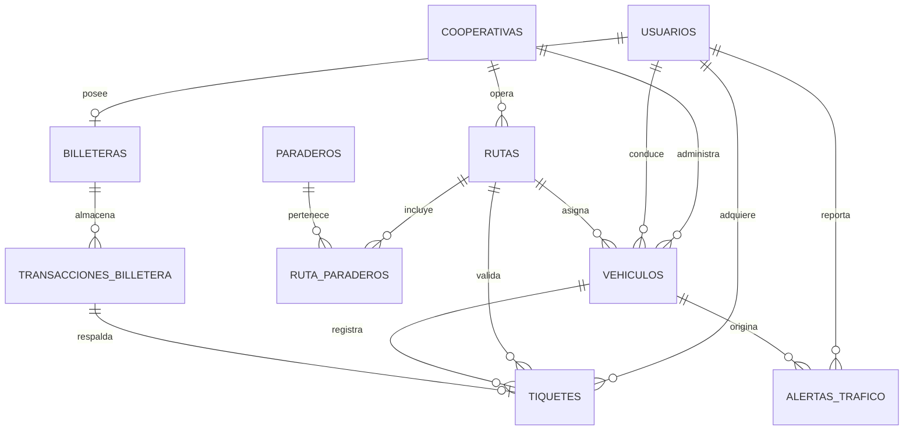

# Modelo de Base de Datos — UberBuses (TransCúcuta Inteligente)

Este directorio contiene el modelo relacional y los scripts SQL correspondientes al sistema de información, planificación de rutas, telemetría de flota y pago digital (**CúcutaPass**) para el Área Metropolitana de Cúcuta.

## Archivos incluidos

- [schema.sql](file:///c:/Users/98765/Documents/universidad/UberBuses/database/schema.sql): Script DDL con la creación de las 10 tablas, restricciones de integridad (`PRIMARY KEY`, `FOREIGN KEY`, `CHECK`) e índices de consulta.
- [seed.sql](file:///c:/Users/98765/Documents/universidad/UberBuses/database/seed.sql): Datos iniciales de prueba alineados con las rutas, cooperativas, vehículos y tarifas reales del prototipo (`$3.400 COP`).

## Diagrama Entidad-Relación (ER)

## Resumen de Entidades

| Tabla | Propósito |
| :--- | :--- |
| `cooperativas` | Empresas transportadoras (Trasan, Corta Distancia, Coomicro). |
| `usuarios` | Cuentas del sistema diferenciadas por rol (`pasajero`, `conductor`, `administrador`). |
| `rutas` | Recorridos metropolitanos, tarifa única, frecuencia y horarios. |
| `paraderos` | Puntos de parada georreferenciados en Cúcuta, Los Patios y Villa del Rosario. |
| `ruta_paraderos` | Tabla intermedia ordenada (`N:M`) entre rutas y paraderos por sentido. |
| `vehiculos` | Unidades en servicio, cupo, velocidad, estado y última posición GPS. |
| `billeteras` | Saldo electrónico de cada pasajero en COP. |
| `transacciones_billetera` | Historial de recargas (Nequi, Daviplata, PSE, Tarjeta) y pagos de pasaje. |
| `tiquetes` | Comprobantes digitales QR/NFC emitidos tras validar el abordaje. |
| `alertas_trafico` | Novedades viales reportadas en ruta (congestión, desvíos). |
